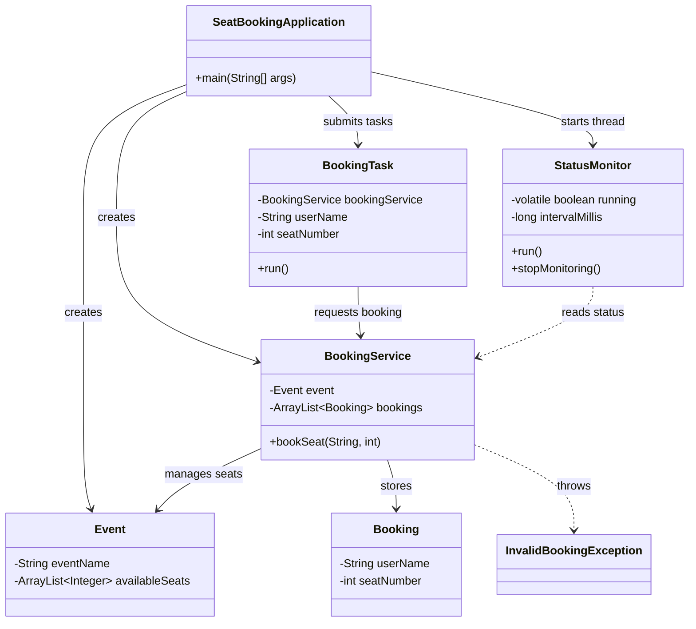

# SeatBookingApplication

A Core Java console application that demonstrates thread-safe seat booking, concurrent task execution, thread visibility, and background status monitoring without external dependencies.

## 📌 Project Overview

The **SeatBookingApplication** simulates an event seat-booking system in which multiple users attempt to reserve seats concurrently.

The application uses Java multithreading to process booking requests, prevents multiple users from booking the same seat, validates seat availability, and periodically displays the booking status.

### Key Features

- In-memory seat and booking management using `ArrayList`.
- Explicit `Thread` creation for background status monitoring.
- `volatile` variable for visibility of the monitoring flag across threads.
- `synchronized` booking method to prevent duplicate seat reservations.
- `ExecutorService` to execute booking tasks concurrently.
- Custom checked exception for invalid booking requests.
- Graceful shutdown of the executor and monitoring thread.
- No database, frameworks, or external dependencies.

## 🛠️ Technologies Used

| Technology | Purpose |
|---|---|
| Core Java | Application logic and object-oriented design |
| Java Threads | Background status monitoring |
| `volatile` | Visibility of shared monitoring state |
| `synchronized` | Thread-safe seat booking |
| `ExecutorService` | Concurrent execution of booking tasks |
| `ArrayList` | In-memory storage of seats and bookings |
| Custom Exception | Handling invalid booking requests |

**Prerequisite:** JDK 8 or later.

## 🏗️ Application Architecture

The application consists of six main classes and one custom exception class.



### Class Responsibilities

| Class | Responsibility |
|---|---|
| `SeatBookingApplication` | Entry point; creates objects, starts the monitor, submits booking tasks, and shuts down resources. |
| `Event` | Represents the event and maintains the available seat numbers. |
| `Booking` | Represents a successful booking with the user's name and seat number. |
| `BookingService` | Validates requests and performs atomic, synchronized seat reservations. |
| `BookingTask` | Encapsulates a user's booking request as a `Runnable` task. |
| `StatusMonitor` | Runs in a dedicated thread and periodically prints booking status. |
| `InvalidBookingException` | Represents an invalid booking request, such as an out-of-range seat number. |

## ⚙️ How the Application Works

1. The application creates a `Java Community Meetup` event with 10 seats.
2. A shared `BookingService` manages the event and all successful bookings.
3. A dedicated monitoring thread starts and periodically prints the booking status.
4. An `ExecutorService` with a fixed pool of three threads executes four booking tasks.
5. Ana and Ravi compete for seat 3, while Meera requests seat 5 and Dev requests seat 11.
6. The synchronized booking method ensures that only one of Ana or Ravi can reserve seat 3.
7. Meera can successfully reserve seat 5, while Dev's request is rejected because seat 11 is outside the valid range.
8. After all tasks finish, the executor is shut down, the monitor is stopped, and the final booking summary is displayed.

**Important:** Thread scheduling is nondeterministic. Either Ana or Ravi can win seat 3; the application must not guarantee which request wins.

## 🧵 Core Java Concepts Demonstrated

### 1. Explicit Thread Creation

The application starts a dedicated monitoring thread using a `StatusMonitor` instance.

```java
StatusMonitor monitor =
        new StatusMonitor(bookingService, 2000);

Thread monitorThread = new Thread(monitor);
monitorThread.start();
```

**Why it is used:** The monitor runs independently of the main application thread and the booking worker threads.

Calling `start()` creates a separate execution path and invokes the task's `run()` method on that thread. Calling `run()` directly would not start a new thread.

### 2. `volatile` for Thread Visibility

The monitor uses a shared flag to determine whether monitoring should continue.

```java
private volatile boolean running = true;

public void stopMonitoring() {
    running = false;
}
```

The monitoring loop checks the flag:

```java
while (running) {
    // Print the current booking status.
    Thread.sleep(intervalMillis);
}
```

**Why it is used:** When the main thread changes `running` to `false`, the monitor thread can observe that change instead of relying on a potentially stale cached value.

`volatile` provides visibility, not mutual exclusion. It does not replace `synchronized` for the seat-booking operation.

### 3. Synchronized Seat Booking

The booking service uses a synchronized method to protect shared seat and booking state.

```java
public synchronized Booking bookSeat(
        String userName, int seatNumber)
        throws InvalidBookingException {

    // Validate the seat number.
    // Check whether the seat is available.
    // Remove the seat from available seats.
    // Create and store the booking.
}
```

**Why it is used:** If two threads request the same seat simultaneously, only one can execute this synchronized method on the same `BookingService` instance at a time.

The availability check and seat removal happen within the same critical section, preventing both users from successfully reserving the same seat.

### 4. ExecutorService and Runnable Tasks

Each booking request is represented by a `BookingTask`.

```java
ExecutorService executor =
        Executors.newFixedThreadPool(3);

executor.submit(new BookingTask(
        bookingService, "Ana", 3));

executor.submit(new BookingTask(
        bookingService, "Ravi", 3));

executor.submit(new BookingTask(
        bookingService, "Meera", 5));

executor.submit(new BookingTask(
        bookingService, "Dev", 11));
```

**Why it is used:** The executor manages a pool of three worker threads and schedules the four submitted tasks without requiring manual thread creation for every booking request.

The shared `BookingService` is essential: all booking tasks must use the same service instance for synchronization to protect the shared booking state.

### 5. ArrayList for In-Memory Storage

The application maintains available seats and successful bookings in `ArrayList` instances.

```java
private final List<Integer> availableSeats =
        new ArrayList<>();

private final List<Booking> bookings =
        new ArrayList<>();
```

**Why it is used:** It provides simple in-memory storage without requiring a database.

The lists are not inherently thread-safe. The booking service must coordinate access appropriately, and getters should return defensive copies when exposing the internal state.

### 6. Custom Exception

The application defines `InvalidBookingException` to represent rejected booking requests.

```java
public class InvalidBookingException extends Exception {

    public InvalidBookingException(String message) {
        super(message);
    }
}
```

**Why it is used:** It separates booking validation failures from ordinary successful execution and allows the task to report meaningful rejection messages.

### 7. Graceful Shutdown

After submitting all tasks, the application waits for booking execution to finish before stopping the monitor.

```java
executor.shutdown();
executor.awaitTermination(10, TimeUnit.SECONDS);

monitor.stopMonitoring();
monitorThread.interrupt();
monitorThread.join();
```

The application should also handle interruption and ensure that worker and monitoring threads are cleaned up correctly. If executor termination times out, it should handle that case explicitly rather than assuming all tasks completed.

## ▶️ How to Run

### Step 1: Clone the repository

```bash
git clone <your-repository-url>
cd SeatBookingApplication
```

Replace the placeholder with your actual repository URL.

### Step 2: Compile the source code

If your Java files are located under `src`, compile them into an output directory:

```bash
javac -d out src/*.java
```

If your source files use packages or nested directories, compile all Java files while preserving their package structure:

```bash
javac -d out $(find src -name "*.java")
```

### Step 3: Run the application

If `SeatBookingApplication` is in the default package:

```bash
java -cp out SeatBookingApplication
```

If it belongs to a package, use its fully qualified class name instead.

**Note:** These commands assume the source layout described above. Adjust the paths if your project uses a different directory structure.

## 🧪 Sample Test Run

The following is an illustrative run showing the expected outcomes. The exact order of messages may vary because multiple worker threads execute concurrently, and status-monitor messages can appear between booking messages.

```text
Starting SeatBookingApplication...

Event: Java Community Meetup
Total Seats: 10

Status Monitor Started
Available Seats: [1, 2, 3, 4, 5, 6, 7, 8, 9, 10]

Ana successfully booked seat 3.
Meera successfully booked seat 5.

Booking Failed for Ravi:
Seat 3 is no longer available.

Booking Failed for Dev:
Invalid seat number: 11

Final Booking Summary
---------------------
Total Successful Bookings: 2
Available Seats: [1, 2, 4, 6, 7, 8, 9, 10]

Stopping Status Monitor...
Application Finished.
```

In this example, Ana wins seat 3. Ravi would be the successful user instead if his task acquired the booking lock first.

The expected final state is the same in either case:

- Two successful bookings.
- Seat 3 reserved by exactly one user.
- Seat 5 reserved by Meera.
- Seat 11 rejected.
- Eight available seats remain.

## 📋 Expected Deliverables Checklist

- [x] Class diagram showing the main application classes and relationships.
- [x] Core Java implementation without external dependencies.
- [x] One custom exception class.
- [x] `ArrayList` for in-memory seat and booking storage.
- [x] Explicit thread creation using `Thread`.
- [x] `volatile` visibility for the monitoring flag.
- [x] Synchronized seat-booking operation.
- [x] `ExecutorService` task execution.
- [x] Demonstration of successful and rejected booking requests.
- [x] Explanation of where each required concept is used.

## 🚀 Possible Future Improvements

- Add automated concurrency tests to verify that duplicate seat bookings never occur.
- Add booking identifiers and cancellation support.
- Introduce a persistent database for storing bookings.
- Add event-specific booking limits and user validation.
- Provide a simple REST API or user interface.

These are possible extensions and are not required for the current Core Java implementation.

## 👨‍💻 Author

**Anjan Kumar Gogu**

Java Backend Developer | Core Java | Multithreading | Spring Boot

